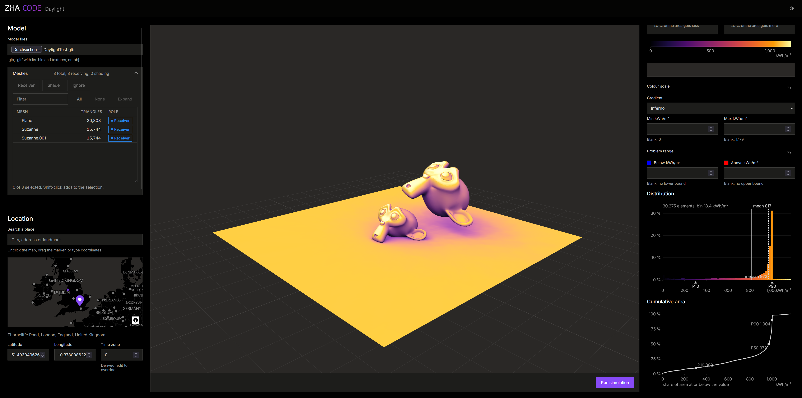

# kit-sim_daylight web

Browser front end and HTTP server for [kit-sim_daylight](https://github.com/Cybernaut0815/kit-sim_daylight) (GPU
annual daylight / solar simulation): open a USD stage (`.usd` / `.usda` / `.usdc` / `.usdz`, as files or a folder with
its assets) or a `.glb` / `.gltf` / `.obj` (turned into USD in the browser) in the
[USD web viewer](https://github.com/Cybernaut0815/USD_WebViewer), pick shade-casting and receiving meshes (or whole
groups) in the stage's prim tree, switch its variants, hide or lock prims as in the viewer, subdivide
catmullClark / loop meshes (creases included) so the run uses the smooth surface, set the site on a map, the weather
(upload, nearest station, PVGIS or clear sky), the time (a single date and time, a date range such as 09:00 to 17:00
every day of the summer, or the whole year) on timelines or by dragging the sun path drawn around the model, and every
CLI option; run on the GPU box (or tick "Run on every change"), read the results on the meshes (per-quantity
gradients, a problem range painted blue / red) and in charts (legend, area-weighted histogram, cumulative area curve,
range split, per-mesh table); the cursor's element is read out on every chart. Download the result as a `.usdz`:
either the result colours replace the receivers' materials (a layer over the model files, packed with them), or the
flattened stage with a variant set `daylight` on each receiver (`original` plus one variant per result); both keep
every result column as a value primvar (`primvars:daylight_<result>`), on the polygons the run simulated: a mesh's own
faces, or the subdivided faces when the run used subdivision, never the triangulation. Styled with the ZHA design system (`zha-ui`, `data-brand="code"`).



```
git clone --recurse-submodules <this repo>
cd server && cmake --preset vs2022 && cmake --build --preset release     # needs VS 2022, CUDA 12.6, OptiX 9 headers, an RTX GPU
cd ../web && npm install && npm run core && npm run build                # needs GitHub access to GitZHACODE/zha-ui
server\build\RelWithDebInfo\daylight_server.exe --web web\dist            # http://localhost:8080
```

`npm run core` fetches the USD viewer's wasm core (`usdcore.js`, `usdcore.wasm`, gitignored) from the viewer's GitHub
Pages into `USD_WebViewer/web/public/core/`, after checking that it was built from the same sources as the pinned viewer
commit, and records that commit in `web/usdcore.pin`; the build refuses a core fetched for another commit, so run it
again after every bump of that submodule (a core built yourself can be copied there instead, see `web/scripts/core.mjs`). The core needs a cross-origin isolated
page: the server and the dev server send the headers, and browsers honour them on `localhost` or over HTTPS.

Development: `cd web && npm run dev` (Vite proxies the API paths to `localhost:8080`; `npm run dev:mock` fakes the
server for GPU-free UI work). Judge speed in the built app served by the server: the dev build adds about 40 ms to
every run (an instant re-run takes about 15 ms from click to the new numbers; an annual one is its compute time, mostly
the CPU sky model, plus about 20 ms).

**API**: several users share the GPU through a job queue; every endpoint is documented by the server itself at
`/docs` (Swagger UI), `/redoc`, `/openapi.json` (OpenAPI 3.1, for agents and code generators) and `/llms.txt`.

- [server/README.md](server/README.md): documentation endpoints, multi-user behaviour (queue, limits, cancel), caching, flags.
- `kit-sim_daylight/`: the core as a git submodule (`git submodule update --init`); its `bindings/ts` is imported by
  the web app through a Vite alias.
- `USD_WebViewer/`: the 3D view (`<usd-viewer>`: OpenUSD in WebAssembly, drawn by three.js) as a git submodule; its
  source is imported through a Vite alias and its `web/public` (the core, the skies) is the app's public folder.
- External services the browser uses directly: OpenFreeMap tiles (`styles/dark`, © OpenMapTiles, data from
  OpenStreetMap), Photon geocoder by komoot (OpenStreetMap data). Through the server: EnergyPlus weather files
  (NREL / DOE), PVGIS (European Commission JRC).

Licence: Apache 2.0 with the Commons Clause, like the core (see `kit-sim_daylight/LICENSE`).
