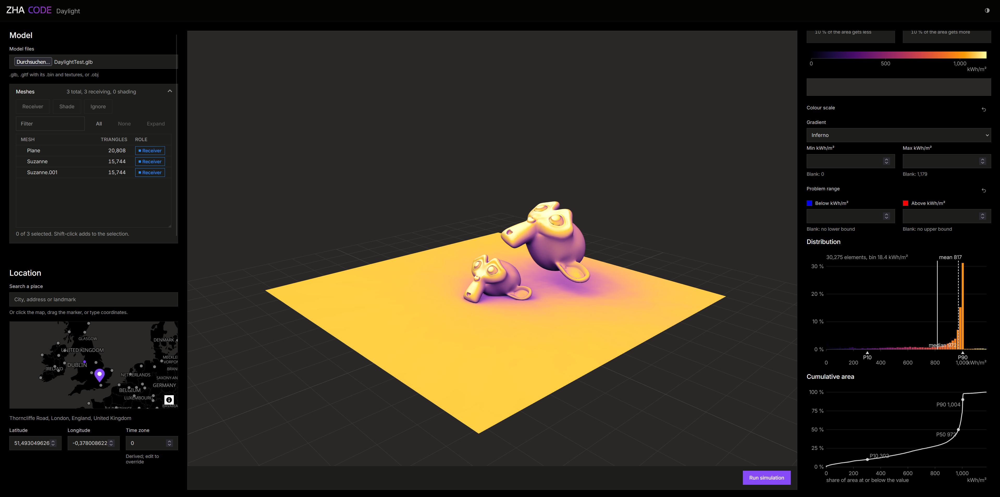

# kit-sim_daylight web

Browser front end and HTTP server for [kit-sim_core](https://github.com/Cybernaut0815/kit-sim_core) (GPU
annual daylight / solar simulation): open a USD stage (`.usd` / `.usda` / `.usdc` / `.usdz`, as files or a folder with
its assets) or a `.glb` / `.gltf` (Draco and meshopt compression too) / `.obj` (with its `.mtl`), turned into USD in the
browser with its materials, UVs and textures, in the [USD web viewer](https://github.com/Cybernaut0815/USD_WebViewer),
pick shade-casting and receiving meshes (or whole groups; a receiver can also measure without casting shade, such as a
grid of points in a room) in the stage's prim tree, switch its variants, hide or lock prims as in the viewer, subdivide
catmullClark / loop meshes (creases included) so the run uses the smooth surface, set
the site on a map, the weather (upload, nearest station, PVGIS or clear sky), the time (a single date and time, a date
range such as 09:00 to 17:00 every day of the summer, or the whole year) on timelines or by dragging the sun path drawn
around the model (or around the selected meshes: *Around selection* in the Time panel), and every CLI option; run on
the GPU box (or tick "Run on every change"), read the results on the meshes (per-quantity gradients, a problem range
painted blue / red) and in charts (legend, area-weighted histogram, cumulative area curve, each over the colour scale
or the whole data range, range split, per-mesh table); the cursor's element is read out on every chart. A bar of the
histogram shows where its values lie on the model, on hover or kept by a click (Shift+click a range, Ctrl+click to add
or remove, a drag across bars). The result shown stays the one picked through new runs and changed roles. *Display*,
*Values on the surfaces* (off by default) writes the values on the painted surfaces where nothing covers them, at most
150 a view, once the camera rests; values from a million on show in exponent form with three digits (1.23e6).

**Receivers keep the file's own mesh.** The 3D view draws every mesh as triangles, with points that share a position
as one vertex. A run does not take that as the mesh: a receiver is sent as the faces and points its file has, so "on
faces" gives one result per face (a quad is one, also in an `.obj`; a glTF file holds triangles) and "on vertices" one
per point of the file, each facing along the faces that name that point. Two parts of a mesh that only meet at a
position keep their own points and directions; the view shows each part's own values there. With subdivision on, the
faces are the subdivided ones.

**Colour scale.** Per result: a gradient (the built-in ones, or your own: *Edit* beside the gradient shows it as a bar
with a handle per stop: drag a handle to move the stop, click the bar for a new one, drag a handle off to remove it,
pick the selected stop's colour; turn the gradient round, save it under a name; a built-in one can be changed and
reset), Min and Max, and a scaling that spreads the values along the gradient: linear, logarithmic, square
root, square, or equalised (every colour covers the same number of elements), to show small differences among low
values, among high ones, or wherever the values lie. The gradients are shared by every result and both analyses, and
kept in the browser with the other settings. Set the 3D view to one of the model's cameras or to a view saved in the app (kept
for the session, never written to a file, removed again from the same menu). Compare up to four models: "+" in the
Model panel adds one (tabs A to D; the Model and Materials panels show the active one, a click in a view makes its model
active), each in its own 3D view (side by side, stacked or 2 x 2; cameras linked or independent); Run runs every model
with a receiver, one after another, and the Results show every model on one colour scale, with its difference to the
first. Download the active model's result from the bar under the 3D views as `.usdz`, `.usda`, `.usdc`, `.usd`,
`.glb`, `.gltf` or `.obj`. In USD either the result colours replace the receivers' materials,
or the flattened stage gets a variant set `daylight` on each receiver (`original` plus one variant per result); both
keep every result column as a value primvar (`primvars:daylight_<result>`) on the polygons the run simulated: a mesh's
own faces, or the subdivided faces when the run used subdivision, never the triangulation. A `.usdz` packs the model
files with it; a `.usda` / `.usdc` / `.usd` is the flattened stage, zipped with the textures it uses. glTF and OBJ hold
the model as drawn, in metres, the receivers coloured with the shown result; glTF also every result as a value
attribute (`_DAYLIGHT_<RESULT>`).
*Info* in the app bar explains the app: a quick start, reading the results, comparing models, the view analysis,
glass and reflective materials, sets and combined views.
Styled with [kit-ui](https://github.com/Cybernaut0815/kit-UI_template) (`data-kit="sim"`, KIT-SIM; `web/src/kit.css`).

**View analysis.** The *View analysis* tab in the app bar runs the core's `views` tool on the same models, meshes and
materials, with roles, settings and results of its own: receivers, obstructions, targets (obstructions whose rays count
for a named group: water, a park, a tower; several groups, listed in the Model panel, are measured in one run) and
ignored meshes; the field of view (out of a window about each face's normal, all
around, or the horizontal ring of the 2D isovist), cell, eye offset, far, reach (EN 17037's 6 / 20 / 50 m or own
distances), the virtual ground and whether rays pass glass. Results per element: the shares of the field that end on
the sky, the ground, an obstruction and each target group, the total obstruction (everything that is not sky: ground,
obstructions and targets), the share seen through glass, the view distances (log mean, nearest) or the isovist (volume, area) and
the reach shares, painted on the meshes (each kind of result in a gradient of its own: sky blues, ground oranges,
obstruction greys, targets greens, distances logarithmic), with the distribution charts, a view composition donut (bars
per model when comparing) and reach bars. Switching tabs keeps each analysis' roles and
results; Daylight's inputs stay as they were.

**Analysis sets and the Combined tab.** *Sets* in the bar under the 3D views saves the tab's whole setup under a name:
per open model (up to four) its roles and Materials edits, each entry linked to its model's letter and file; the
Daylight or View analysis settings, north, the site and weather (Daylight; an uploaded EPW by its file name), the
result shown, the colours, the charts and the subdivision level (display switches and per-mesh refinements are not
kept). Sets are kept on the server (`/sets`, for every browser and the agent). Opening one gives each model its own
entry only (its letter and file, or its file reopened in another tab); a model without one keeps its roles, and the
note says per model what it took. A set's fold-out lists what it keeps and offers *Copy to model*: a new set of one
entry for another model, with the roles and Materials edits whose USD paths that model has (every other mesh without a
role), opened at once to edit. The Model, Materials and Location panels reset the roles to how the file opened, every
Materials edit, and the site to the user's own position (when the browser shares it). Results stay at hand while the page
is open (a session cache of 512 MB), so a set opened again shows its result without a run. The **Combined** tab, always
the last, saves the Daylight or View analysis setup now as a new set and lists the sets of each tab, each a fold-out with
its state per model (*Run* computes the missing results in the background; *Update from the current setup*; *Rename*,
its id kept so combined views follow), and the combined views, each input a fold-out of its own: up to 8 inputs, each a set's result column through a function (as it is, normalised, inverted, log10,
a threshold or a band), weighted and limited to some meshes, combined by weighted mean or sum, minimum, maximum or
product into one value per element, painted on every model with the Results charts.

**Materials.** By default every surface is opaque and black (today's numbers and speed, as Ladybug's RadiationStudy);
only the virtual ground reflects (*Ground reflectance*). Two switches in Simulation, each slower, add what the model's
materials do: *Transmission* lets glass (by angle, as Radiance glass, unless *Angle-dependent glass* is off), screens
and cut-out trees pass their transmittance τ, and *Reflections* (off, 1-20; 1 for outdoor studies, 5-8 for interiors;
*Reflection samples* under Advanced, 1024) adds the light the model's own surfaces reflect by their reflectance ρ. The
Materials table reads each material's kind, ρ and τ from its own settings, never its name: opacity, cut-out and opacity
texture tell glass (the default glass: double low-e, τ 0.64) and porous apart, the colour or colour map gives ρ (its
luminance, 0.02-0.9; no colour of its own: the default 0.20); edit a value or pick a preset (kept while the model is
open: re-reads keep them, opening another model clears them). Ladybug mode keeps every surface opaque and black. More
precise: Transmission on, 2 reflections, 4096 samples.



## Start

The app is two parts: `daylight_server.exe` (C++, runs the simulations on the GPU) and the web app (`web/`), which the
server also serves. Build both once, then start the server and open the page.

**You need** Windows 10/11 x64, an NVIDIA GPU of compute capability 7.5 or newer (Turing and later) with driver R570+,
Visual Studio 2022 (C++ workload), CMake 3.27+, CUDA 12.6, the OptiX 9 SDK headers, Node.js 20+, and GitHub access to
`Cybernaut0815/kit-UI_template` (the `kit-ui` design system, fetched by `npm install`). Details and why containers on
WSL2 cannot run it (OptiX is not in NVIDIA's WSL driver; a Linux GPU host is the container path, and the OptiX SDK
licence restricts hosted / internet use by third parties) are in the core's [README](kit-sim_daylight/README.md#build).

**1. Get the code** (with both submodules: the core and the USD viewer)

```powershell
git clone --recurse-submodules https://github.com/Cybernaut0815/kit-sim_daylight-UI.git
cd kit-sim_daylight-UI
```

**2. Build the server** (from the repository root; a few minutes the first time, CUDA included)

```powershell
cd server
cmake --preset vs2022
cmake --build --preset release          # -> server\build\RelWithDebInfo\daylight_server.exe
cd ..
```

**3. Build the web app**

```powershell
cd web
npm install
npm run core                            # the USD viewer's wasm core (once, and after every USD_WebViewer bump)
npm run build                           # -> web\dist
cd ..
```

**4. Start the server with the web app and open it**

```powershell
server\build\RelWithDebInfo\daylight_server.exe --web web\dist
```

Open **http://localhost:8080** (use `localhost`, not `127.0.0.1` or the machine's name: the 3D view needs a
cross-origin isolated page, which browsers allow on `localhost` or over HTTPS). The window running the server shows
its log; Ctrl+C stops it. Useful flags: `--port 8090`, `--mcp` (let Claude Code / Desktop drive the app, see
[server/README.md](server/README.md#agents-mcp)); every flag is in [server/README.md](server/README.md#flags).

The app has three tabs in its top bar: **Daylight** and **View analysis**, on the same models, and **Combined**, the
saved sets' results weighed together. Open a model in the Model
panel (or try `server\test\building.usda`), select meshes in the prim tree, give them roles, and press *Run*.
*Info* in the top bar explains the rest.

**After pulling changes**: rebuild what changed (step 2 for `server/` or the `kit-sim_daylight` submodule, step 3 for
`web/`; `npm run core` again when `USD_WebViewer` moved; run `git submodule update` first), then restart the server.

`npm run core` fetches the USD viewer's wasm core (`usdcore.js`, `usdcore.wasm`, gitignored) from the viewer's GitHub
Pages into `USD_WebViewer/web/public/core/`, after checking that it was built from the same sources as the pinned viewer
commit, and records that commit in `web/usdcore.pin`; the build refuses a core fetched for another commit, so run it
again after every bump of that submodule (a core built yourself can be copied there instead, see `web/scripts/core.mjs`).

### Working on the web app

Start the server as in step 4 (it answers the API on port 8080; `--web` is not needed), then in a second window:

```powershell
cd web
npm run dev                             # http://localhost:5173, reloads on every edit; the API goes to localhost:8080
```

Without a GPU, `npm run dev:mock` fakes the server (random numbers, both analyses). Another server address:
`$env:DAYLIGHT_API = 'http://127.0.0.1:8090'` before `npm run dev`. Tests: `npm test` (vitest). Judge speed in the built
app served by the server: the dev build adds about 40 ms to every run (an instant re-run takes about 15 ms from click to
the new numbers; an annual one is its compute time, mostly the CPU sky model, plus about 20 ms).

**API**: several users share the GPU through a job queue; every endpoint is documented by the server itself at
`/docs` (Swagger UI), `/redoc`, `/openapi.json` (OpenAPI 3.1, for agents and code generators) and `/llms.txt`.

**Agents (MCP).** Started with `--mcp`, the server lets Claude Code (over HTTP) or Claude Desktop (through
`server/mcp-stdio.mjs`) work with the app: open models by path, set roles, settings and cameras, run, read and discuss
the results, find critical areas, take screenshots of any shape, section the views with clipping planes and boxes (view
only: runs use the whole model), set up the Results charts, and write PDF reports on one option or 2 to 4 compared, in
the kit-ui report layout. The tools drive both analyses (an `analysis` parameter, Daylight by default), save, open and
run sets, and build combined views. The app has no chat: the agent drives the open tab and every change shows there;
with no tab open the server runs the app hidden in headless Chrome, and opening the app picks that session up. Report
charts and cameras stay editable in the app (the chart settings button, the Views menu), and the Reports menu generates
the PDF again: a report keeps the Daylight setup it was saved with (roles, settings, problem ranges), which generating
opens first. The agent routes answer only on this machine; setup in [server/README.md](server/README.md#agents-mcp).

- [server/README.md](server/README.md): documentation endpoints, multi-user behaviour (queue, limits, cancel), caching, flags.
- `kit-sim_daylight/`: the core (GitHub repo `kit-sim_core`) as a git submodule (`git submodule update --init`); its
  `bindings/ts` is imported by the web app through a Vite alias.
- `USD_WebViewer/`: the 3D view (`<usd-viewer>`: OpenUSD in WebAssembly, drawn by three.js) as a git submodule; its
  source is imported through a Vite alias and its `web/public` (the core, the skies) is the app's public folder.
- External services the browser uses directly: OpenFreeMap tiles (`styles/dark`, © OpenMapTiles, data from
  OpenStreetMap), Photon geocoder by komoot (OpenStreetMap data). Through the server: EnergyPlus weather files
  (NREL / DOE), PVGIS (European Commission JRC).

Licence: Apache 2.0 with the Commons Clause, like the core (see `kit-sim_daylight/LICENSE`).
